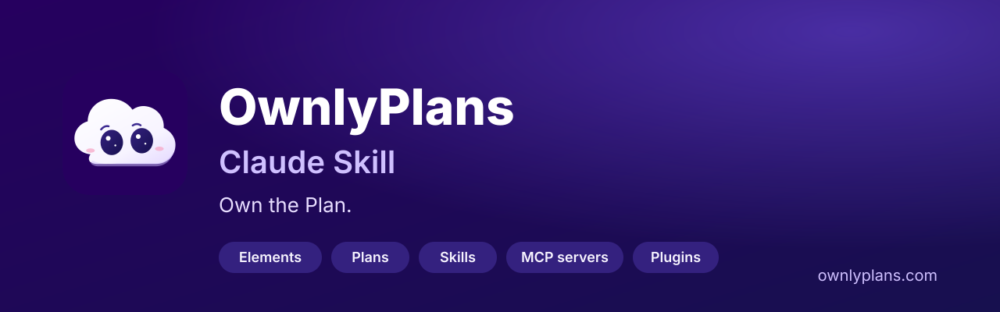
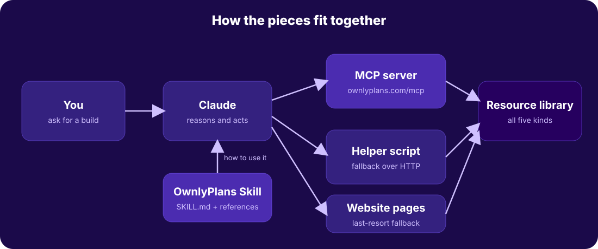
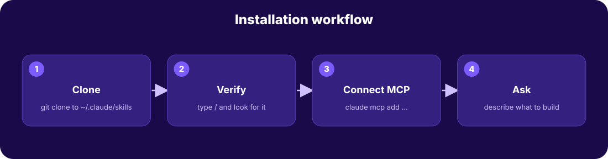
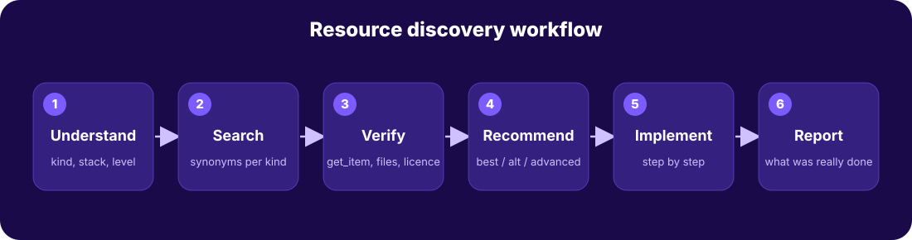

<p align="center"></p>

# OwnlyPlans Claude Skill: Find UI Components, AI Development Plans, Claude Skills, MCP Servers and Plugins

**Your AI-powered development companion for discovering and using UI elements, development plans, Claude skills, MCP servers and plugins from [OwnlyPlans](https://ownlyplans.com/).**

A free, open-source **Claude Code skill** (and Claude skill for other Claude products) for **vibe coding** and AI-assisted development. Ask Claude to build a SaaS dashboard, landing page, e-commerce site or AI chatbot, and it searches the OwnlyPlans library of **UI components, step-by-step build plans, Claude skills, MCP servers and Claude Code plugins**, verifies what it finds and helps you ship.

*Own the Plan.*

[](https://github.com/Bhaskar-mar/ownlyplans-claude-skill/actions/workflows/validate.yml)
[](LICENSE)

## Contents
- [What is OwnlyPlans?](#what-is-ownlyplans)
- [What this skill does](#what-this-skill-does)
- [Features](#features)
- [Resource categories](#resource-categories)
- [Install](#install)
- [Usage](#usage)
- [Example conversation](#example-conversation)
- [How discovery works](#how-discovery-works)
- [MCP integration](#mcp-integration)
- [Configuration](#configuration)
- [Troubleshooting](#troubleshooting)
- [Contributing](#contributing)
- [License](#license)

## Who is this for?
Developers, designers, founders, students and AI builders who use Claude Code, Claude or other MCP-compatible AI coding tools and want proven starting points: React and plain HTML/CSS/JS UI components, AI app builder roadmaps, agent skills, MCP server setups and Claude Code plugin marketplaces.

## What is OwnlyPlans?
[OwnlyPlans](https://ownlyplans.com/) is a community library for people who build with AI coding tools: *Copy what works. Let AI build the rest.* It holds live UI elements, step-by-step plans, Claude skills, MCP servers and Claude Code plugins.

## What this skill does
When you ask Claude to build something, this skill makes Claude search OwnlyPlans first, **verify** what it finds, recommend the best fit, and help you apply it. It teaches Claude *how* to use OwnlyPlans. The [MCP server](#mcp-integration) is what gives Claude *live access*. Together they make OwnlyPlans a working part of your workflow, not just a directory.

<p align="center"></p>

## Features
- Natural-language discovery across five resource kinds
- Intent detection and smart query expansion (a "CRM dashboard" also searches tables, charts, auth, forms)
- Verification before recommending: existence, stack fit, licence, files and install command
- Three-tier recommendations: **Best match**, **Alternative**, **Advanced option**
- Guided implementation: plans walked step by step, with real build and test results reported
- Strict honesty: no invented items, links, install commands, ratings or compatibility
- Works with MCP, a standard-library helper script, or plain website pages
- Dynamic: nothing is hardcoded, so it stays useful as the library grows

## Resource categories
| Kind | What it is | Section |
|---|---|---|
| `component` | Live UI elements with copy-ready code | [/components/](https://ownlyplans.com/components/) |
| `plan` | Step-by-step builds with prompts and checks | [/plans/](https://ownlyplans.com/plans/) |
| `skill` | `SKILL.md` files that teach Claude a task | [/skills/](https://ownlyplans.com/skills/) |
| `mcp` | MCP servers for data, browsers and services | [/mcp-servers/](https://ownlyplans.com/mcp-servers/) |
| `plugin` | Claude Code plugin marketplaces | [/plugins/](https://ownlyplans.com/plugins/) |

## Install
<p align="center"></p>

Claude Code (personal install):
```bash
git clone https://github.com/Bhaskar-mar/ownlyplans-claude-skill.git ~/.claude/skills/ownlyplans
```
Verify: type `/` in Claude Code and look for `ownlyplans`. Update with `git -C ~/.claude/skills/ownlyplans pull`. Uninstall with `rm -rf ~/.claude/skills/ownlyplans`.

Connect the MCP server (separate step, recommended):
```bash
claude mcp add --transport http ownlyplanscom https://ownlyplans.com/mcp
```
Full guide, including project installs and Claude.ai: [docs/installation.md](docs/installation.md).

## Usage
Try these prompts:
- Find the best UI elements for a modern SaaS dashboard.
- Create a complete development roadmap for my startup.
- Find Claude skills that improve my coding workflow.
- Recommend MCP servers for my project.
- Help me build a responsive landing page using OwnlyPlans resources.
- Find the best resources for building an AI application.

More in the [usage guide](docs/usage-guide.md) and [examples](examples/).

## Example conversation
> **You:** Find the best UI elements for a modern SaaS dashboard. Plain HTML/CSS/JS.
>
> **Claude:** *(searches components for sidebar, table, status, pagination, checks each)*
> **Best match: Collapsible Icon Rail Sidebar** - https://ownlyplans.com/bhaskar/collapsible-icon-rail-sidebar/ - gives your dashboard its shell and is plain HTML/CSS/JS. Install: copy the code from the page. Limits: demo content is placeholder.
> **Alternative: Sortable Data Table** - sortable columns, row selection, status badges.
> *Verified: fetched both items. Not verified: how they look in your app.*

That is an illustration. Results always come from the live catalogue. See [examples/saas-dashboard.md](examples/saas-dashboard.md).

## How discovery works
<p align="center"></p>

1. Detect what you need (component, plan, skill, MCP server, plugin or a mix).
2. Search with several short queries and synonyms.
3. Verify each finalist (`get_item`, files, licence, install command).
4. Recommend up to three tiers with reasons and limits.
5. Implement step by step if you ask.
6. Report what was actually done and checked.

## MCP integration
The OwnlyPlans MCP server is public and read-only at `https://ownlyplans.com/mcp` and offers five tools: `search_items`, `get_item`, `get_step`, `get_asset`, `list_trending`. Details: [references/mcp-integration.md](references/mcp-integration.md). If MCP is not connected, the skill falls back to `scripts/ownlyplans_mcp.py` (Python standard library only) and then to the public website pages.

## Configuration
None required. Optional: set `OWNLYPLANS_MCP_URL` to use a different MCP endpoint with the helper script.

## Troubleshooting
See [references/troubleshooting.md](references/troubleshooting.md) and the [FAQ](docs/faq.md). Quick fixes: skill missing from `/skills` means the folder must be `~/.claude/skills/ownlyplans/SKILL.md`; "cannot reach OwnlyPlans" usually means network access is blocked, so connect the MCP server from your machine.

## Related searches this project answers
Claude Code skills, Claude skills for developers, MCP server directory, UI component library for AI coding, AI development plans and roadmaps, Claude Code plugins, vibe coding resources, SaaS dashboard components, landing page components, AI agent skills, `SKILL.md` examples.

## Contributing
Improvements to the skill are welcome: see [CONTRIBUTING.md](CONTRIBUTING.md). To add resources (elements, plans, skills, MCP servers, plugins) to the library itself, use [ownlyplans.com/submit-a-plan/](https://ownlyplans.com/submit-a-plan/).

## Testing
```bash
python3 scripts/validate_skill.py && python3 scripts/test_skill.py
```
See [docs/testing.md](docs/testing.md) for what is and is not covered.

## License
MIT. See [LICENSE](LICENSE). The MIT licence was chosen so anyone can reuse and adapt the skill. Resources listed on OwnlyPlans carry their own licences, shown on each item.

---
**OwnlyPlans - Own the Plan.** https://ownlyplans.com/
